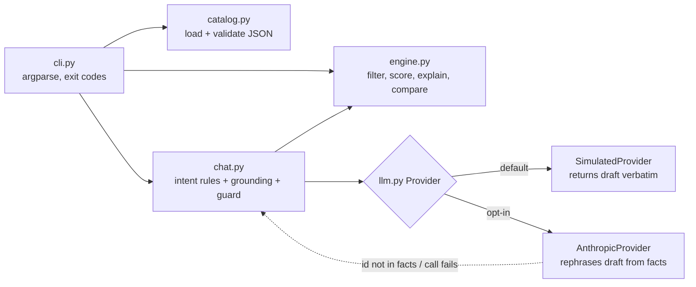

# decision-guide


An explainable decision assistant over a **synthetic** home-office catalog. Give it a category, a budget, and ordered priorities; it filters, ranks, explains every score, compares items side by side, and answers follow-up questions without ever stepping outside the catalog.

> Everything here is invented: product names, prices, attributes. It is a portfolio project built from public knowledge, not an employer project, and it has no affiliation with any retailer.

## Who it is for and what problem it solves

**Audience:** engineers and product people evaluating how to build recommendation + conversational features that stay honest.

**Problem:** "chat with a catalog" demos usually let the model do the ranking, so nobody can say *why* an item won or trust that a mentioned product exists. This project inverts that: a deterministic engine makes every decision and exposes its reasoning; a language model is optional and is only allowed to *phrase* answers the engine already grounded.

**MVP scope (complete):**
- Needs-and-budget filtering with hard constraints (category, budget, must-have / avoid features), each exclusion reported with its reason
- Weighted, inspectable scoring (every contribution visible)
- Two-item comparison with per-dimension edge
- Conversational follow-up: `what is`, `why not`, `compare`, `what if my budget is`, `cheaper`, `best`, plus a graceful out-of-scope reply
- Offline by default; optional Claude integration with a hallucination guard

## Stack and why

- **Python 3.10+, standard library only** for the core. A recommendation engine of this size does not need a framework, and zero dependencies keeps the demo runnable anywhere for free.
- **pytest + coverage** for tests; **GitHub Actions** for CI on two Python versions.
- **`anthropic` SDK as an optional extra** so the real-model path is one `pip install` away without making it a requirement.
- No database: the catalog is a JSON file validated on load. Swapping in a real store means replacing `load_catalog()`.

## Quick start (no credentials needed)

```bash
git clone <this repo> && cd decision-guide
pip install -e ".[dev]"
decision-guide validate
decision-guide recommend --category chair --budget 350 --priority ergonomics --priority quiet
decision-guide compare mon-02 mon-03 --priority eye-comfort --priority value
decision-guide chat --category chair --budget 350 --priority ergonomics --script data/demo_script.txt
make test
```

`decision-guide chat ...` without `--script` opens an interactive prompt.

### Optional: real model phrasing

```bash
cp .env.example .env            # .env is git-ignored
pip install -e ".[llm]"
export DECISION_GUIDE_LLM_PROVIDER=anthropic
export ANTHROPIC_API_KEY=...
export DECISION_GUIDE_LLM_MODEL=<model id from https://docs.claude.com/en/docs/about-claude/models>
decision-guide chat --category monitor --budget 400 --priority eye-comfort
```

The model receives only the grounded draft and the facts behind it. If it mentions an item id that is not in the facts, or the call fails, the CLI shows the grounded draft and says so.

## Walkthrough (actual output)

```
$ decision-guide recommend --category chair --budget 350 --priority ergonomics --priority quiet
Needs: category=chair budget=$350 priorities=ergonomics,quiet

#1 Halden ErgoFlex 2 (chr-02)  $329  score=6.03
   why: ergonomics=4.0, quiet=2.0, budget-headroom=0.03
   strengths: ergonomics 4/5, quiet 4/5
   notes: Mid-range with adjustable lumbar and arms; 5-year warranty (fictional).

#2 Kessler Kneeling Stool (chr-04)  $119  score=5.83
   why: ergonomics=3.0, quiet=2.5, budget-headroom=0.33
   strengths: quiet 5/5
   notes: Posture-focused but not suited to all-day sitting; folds flat.

#3 Fenwick Basic Task Chair (chr-01)  $139  score=4.33
   ...
Excluded chairs:
  - Orison Studio Pro (chr-03): $689 exceeds budget $350
  - Marlow Leather Executive (chr-05): $449 exceeds budget $350
```

```
$ decision-guide chat --category chair --budget 350 --priority ergonomics --script data/demo_script.txt
[provider: simulated - simulated, no model is called]
Starting point: Halden ErgoFlex 2 (chr-02) at $329.

> why not chr-03
[why-not] Orison Studio Pro (chr-03) was excluded: $689 exceeds budget $350.

> compare chr-02 and chr-05
[compare] Comparing Halden ErgoFlex 2 (chr-02) and Marlow Leather Executive (chr-05):
price: chr-02=$329 | chr-05=$449 -> chr-02
ergonomics: chr-02=4/5 | chr-05=3/5 -> chr-02
unique features: chr-02=4d-arms, lumbar-adjust, mesh-back | chr-05=headrest, padded -> tie

> what if my budget is 150
[budget] With a $150 budget the top pick becomes Kessler Kneeling Stool (chr-04) at $119.

> what is the weather tomorrow
[out-of-scope] I can only answer about items in this catalog and your stated needs. ...
```

## Architecture



`engine.py` is pure: no I/O, no model. `chat.py` owns the only place a model can speak, and validates what comes back.

## Design tradeoffs

- **Harmonic priority weights (1, 1/2, 1/3...)** instead of equal weights. Early tuning used linear decay and a large budget-headroom bonus; that made a cheap kneeling stool outrank a proper chair for an "ergonomics first" user. The fix was to let the first priority dominate and cap headroom at a tie-breaker. The score is less "balanced" but matches how people state needs.
- **Rules-based intent parsing** rather than a model classifier. Six intents cover the follow-ups that matter, they are testable, and a wrong parse degrades to a clear out-of-scope message rather than an invented answer.
- **The model never ranks.** This costs some conversational flair (the simulated provider is terse) in exchange for answers that are reproducible and auditable.
- **Exit codes distinguish usage (2), data (3), and provider (4) failures** so the CLI composes in scripts.

## Limitations

- Attribute scores are hand-authored 1-5 integers; real catalogs need normalization from measurable specs.
- Intent parsing is English-only and keyword-driven; "is the ErgoFlex any good" (no id) falls to out-of-scope.
- The hallucination guard checks item ids only. A real model could still misstate a price in prose; adding a numeric fact check is the obvious next step.
- No persistence of chat sessions; no web UI.
- The real-model path was implemented and tested against a fake client, not exercised against a live API in this repository's verification run.

## Verification

Run on Python 3.12.3, 2026-10-27:

```
$ python -m pytest --cov=decision_guide --cov-report=term-missing
40 passed in 0.29s
TOTAL  512 stmts  53 miss  90% coverage
```

Coverage by module: engine 100%, catalog 94%, chat 88%, cli 86%, llm 84%. Tests cover malformed catalogs, empty results, every chat intent, a fake model that invents an item id (guard fires), and a fake model that throws (fallback fires). CI runs the same suite plus a CLI smoke test on Python 3.10 and 3.12.

## Simulated behavior, labelled

`DECISION_GUIDE_LLM_PROVIDER=simulated` (the default) calls no model; the chat prints `[provider: simulated - simulated, no model is called]` so this is never mistaken for AI output. Nothing in this repository has been used in production or measured for performance.

## License

MIT
